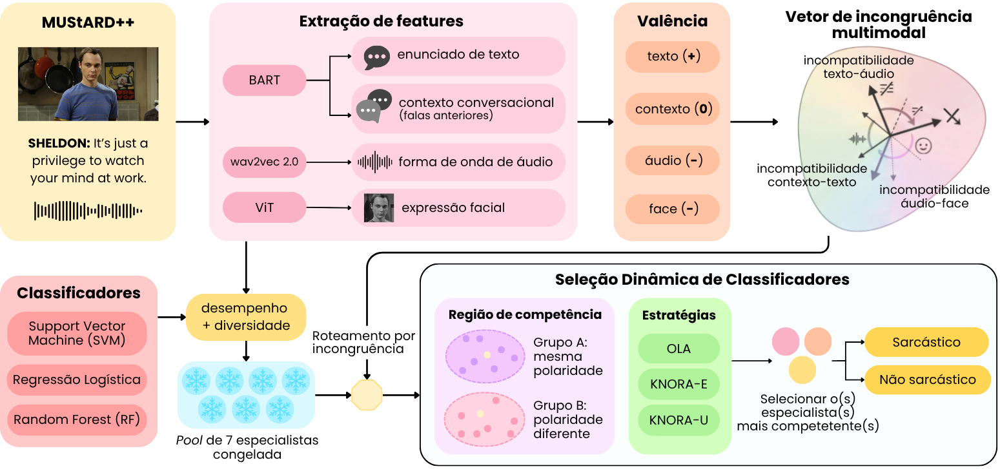

# Seleção Dinâmica de Classificadores para Detecção Multimodal de Sarcasmo

Projeto da disciplina Experiência Criativa: Projeto Transformador II (PUCPR).

O objetivo é investigar se a **incongruência intermodal** (desacordo de polaridade emocional entre texto, contexto, áudio e rosto) funciona como critério explícito de competência na **Seleção Dinâmica (DS) de classificadores** para detecção multimodal de sarcasmo, em comparação com classificadores estáticos e com uma arquitetura Soft-MoE.

- **Dataset:** [MUStARD++](https://github.com/cfiltnlp/MUStARD_Plus_Plus) — 1202 falas (601 sarcásticas, 601 não), com vídeo, áudio, transcrição e contexto conversacional anterior a cada fala, 27 falantes.
- **Resultado principal:** os classificadores estáticos (SVM e voto
dos três modelos) obtiveram o maior F1-macro médio (80.1).
A melhor DS foi o KNORA-U, com F1-macro médio entre
79.2 e 79.3 nas suas variantes, e o Soft-MoE obteve 78.3. Os
testes estatísticos não indicaram diferenças significativas entre
os métodos, e o roteamento por incongruência também não
alterou os resultados de forma significativa. Ainda assim, o
**oráculo atingiu 91.0 de acurácia**, o que evidencia potencial, mas o seletor não aproveitou.

## Exemplificação do método proposto


---

## Visão geral do sistema

```
                    MUStARD++ (1202 falas)
                             |
      10 splits por falante: TREINO ~70% | DSEL ~15% | TESTE ~15%
                             |
          +------------------+-------------------+
          |                                      |
   Representações                         Valência emocional
   (BART, wav2vec2, rosto)                de cada modalidade
          |                                      |
   Seleção da pool (CV no TREINO)         Cálculo de Incongruência
   45 candidatos -> 7 especialistas              |
          |                               Grupo A/B (as 4 concordam ou não)
   Pool congelada (treinada no TREINO)    e grupo de conflito (pos x neg)
          |                                      |
          +-----------+--------------+-----------+
                      |              |
         Seleção Dinâmica         Soft-MoE
         (DSEL como consulta)     (gate MLP treinado no DSEL)
         OLA | KNORA-E | KNORA-U
         sem | A/B | conflito | controles aleatórios
                      |              |
                      +------+-------+
                             |
          Avaliação no TESTE x estáticos (SVM, LR, RF, voto)
                             |
          Agregação dos 10 splits + testes estatísticos
```

### Papel de cada conjunto

| Conjunto | Papel |
|---|---|
| **Treino** | Escolher e treinar os classificadores. Depois eles ficam congelados. |
| **DSEL** | Base de consulta da seleção dinâmica e treino do gate do MoE. |
| **Teste** | Só mede o resultado final. Nenhum parâmetro é escolhido com ele. |

A divisão é sempre **por falante**: todas as falas de um personagem ficam no mesmo conjunto.

---

## 1. Splits

O experimento final usa **10 splits** (`data/splits/split_00` a `split_09`), gerados por `src/data/create_splits_repetidos.py`. Mais detalhes: [`src/data/README.md`](src/data/README.md)

- **Seeds percorridos em ordem** (0, 1, 2, …); ficam os 10 primeiros que passam no critério de aceitação: DSEL e teste com **120 a 240 falas** e **40% a 60% de sarcasmo** cada.
- **Por que o critério:** o MUStARD++ tem só 27 falantes, muito desiguais (CHANDLER sozinho tem 157 falas, 76% sarcásticas). Sem controle, os seeds 0 a 9 geravam DSEL de 49 a 365 falas e teste com 27% a 60% de sarcasmo.
- **Seeds aceitos:** 8, 18, 30, 45, 46, 48, 70, 96, 100 e 111 (112 seeds testados).

| | Treino | DSEL | Teste |
|---|---|---|---|
| Falas por split | 744 a 880 | 136 a 230 | 126 a 228 |
| Falantes por split | 18 | 4 | 5 |
| Grupo A por split | 95 a 135 | 16 a 38 | 16 a 49 |

## 2. Representações (entrada dos classificadores)

| Modalidade | Representação | Dimensão |
|---|---|---|
| Texto (fala) | `facebook/bart-base`, média dos estados ocultos | 768 |
| Contexto (falas anteriores) | `facebook/bart-base`, média dos estados ocultos | 768 |
| Áudio | `facebook/wav2vec2-base-960h`, média no tempo | 768 |
| Rosto | Média e desvio das 7 emoções faciais, nº de rostos e indicador de ausência | 16 |

Detalhes em: [`src/features/README.md`](src/features/README.md)

## 3. Valência e grupo de incongruência

Para cada modalidade, um classificador de emoções pré-treinado dá a distribuição sobre as emoções. A **valência** é `P(positivas) − P(negativas)`, de −1 a +1. A emoção predominante define a polaridade:

- **positiva:** happy
- **negativa:** angry, disgust, fear, sad
- **neutra:** neutral, surprise ou sem sinal (entrada vazia ou rosto ausente)

| Modalidade | Classificador de emoções |
|---|---|
| Texto e contexto | `Tanneru/Emotion-Classification-DeBERTa-v3-Large` |
| Áudio | `iic/emotion2vec_plus_large` |
| Rosto | `mo-thecreator/vit-Facial-Expression-Recognition` (ViT), aplicado às faces detectadas com MTCNN |

- **Grupo A:** as 4 modalidades têm a mesma polaridade (concordam).
- **Grupo B:** pelo menos uma difere (discordam).
- **Conflito:** pelo menos um par de modalidades com polaridades opostas (positiva × negativa). Neutro não conta como discordância. São 330 falas com conflito e 872 sem; o grupo A/B é bem mais desigual (173 × 1029).

A incongruência **não entra como feature** dos classificadores. Ela só define o grupo usado no roteamento, mais detalhes em [`src/incongruence/README.md`](src/incongruence/README.md).

## 4. Pool de 7 especialistas

Refeita em cada split, usando só o treino. Detalhes em: [`src/pool_selection/README.md`](src/pool_selection/README.md)

1. **45 candidatos:** 15 combinações de modalidades × 3 classificadores (SVM, regressão logística, random forest).
2. **Validação cruzada** estratificada por falante (5 folds) com busca em grade de hiperparâmetros e F1-macro como critério.
3. **Escolha gulosa** entre os 15 melhores: `0,7 × desempenho normalizado + 0,3 × discordância média` com os já escolhidos, até 7 membros.
4. **Treino final** dos 7 no treino inteiro ([`src/pool_training/README.md`](src/pool_training/README.md)).

Composição dos 70 membros (7 por split × 10):

| Modalidade | % dos membros | Classificador | % dos membros |
|---|---|---|---|
| Contexto | 98,6 | SVM | 52,9 |
| Áudio | 64,3 | Regressão logística | 31,4 |
| Texto | 61,4 | Random forest | 15,7 |
| Rosto | 52,9 | | |

## 5. Seleção dinâmica

Para cada fala de teste, procuram-se os **k = 7 vizinhos** mais parecidos no DSEL e verifica-se quais membros acertaram esses vizinhos (detalhes em: [`src/selection/README.md`](src/selection/README.md)). O espaço de vizinhança concatena as 4 modalidades, cada uma padronizada (ajustada no treino) e normalizada (L2).

| Método | Quem decide |
|---|---|
| **OLA** | O membro que mais acertou os vizinhos |
| **KNORA-E** | Votam só os que acertaram **todos** os vizinhos (se nenhum, reduz a vizinhança) |
| **KNORA-U** | Todos votam, com peso = nº de vizinhos acertados |

| Roteamento | Onde procura os vizinhos | O que testa |
|---|---|---|
| **Sem roteamento** | No DSEL inteiro | Linha de base |
| **A/B** | Só no DSEL do mesmo grupo da fala de teste | Efeito da incongruência |
| **Aleatório** | Em grupos sorteados do DSEL com o mesmo tamanho de A e B (10 sorteios; vale a média) | Separa a incongruência do simples fato de restringir a vizinhança |
| **Conflito** | Só no DSEL do mesmo grupo de conflito da fala | Incongruência sem contar neutro como discordância |
| **Conflito aleatório** | Grupos sorteados com o mesmo tamanho dos de conflito | Controle do roteamento por conflito |

## 6. Soft-MoE

Combina as probabilidades dos mesmos 7 membros com pesos dados por um **gate** (detalhes em: [`src/moe/README.md`](src/moe/README.md)).

- Gate: MLP com entrada das 4 modalidades (2320 dimensões), camada de 32 neurônios, ReLU, dropout 0,2 e softmax sobre os 7 membros (cerca de 74,5 mil parâmetros).
- Treinado no DSEL com entropia cruzada binária, Adam (taxa 0,001, weight decay 0,0001), lotes de 32, até 200 épocas e paciência de 20.
- O gate não recebe a incongruência.

## 7. Classificadores estáticos

Treinados uma vez no treino e aplicados igual a todas as falas, com **as 4 modalidades juntas**: SVM, regressão logística, random forest (hiperparâmetros da validação cruzada da pool) e o voto dos 3. Detalhes em: [`src/static/README.md`](src/static/README.md)

---

## Protocolo e configuração final do experimento principal

| Componente | Configuração |
|---|---|
| **Dados** | MUStARD++: 1202 falas (601 sarcásticas), 27 falantes |
| **Splits** | 10 splits com `GroupShuffleSplit` por falante, aproximadamente 70% treino (744 a 880 falas, 18 falantes), 15% DSEL (136 a 230 falas, 4 falantes) e 15% teste (126 a 228 falas, 5 falantes); Foram aceitos apenas splits com 120 a 240 instâncias em DSEL e TEST e proporção de sarcasmo entre 40% e 60%. |
| **Representações** | Texto e contexto: BART-base (média dos estados ocultos, 768 dim cada); áudio: wav2vec2-base-960h (média no tempo, 768 dim); rosto: 16 características - média e desvio-padrão das 7 probabilidades, nº de rostos e indicador de ausência. Total: 2320 dimensões |
| **Emoção por modalidade** | Texto e contexto: DeBERTa-v3-large (`Tanneru/Emotion-Classification-DeBERTa-v3-Large`); áudio: emotion2vec+ large; rosto: `mo-thecreator/vit-Facial-Expression-Recognition`, aplicado às faces detectadas com MTCNN. Polaridade pela emoção predominante (argmax) |
| **Pool** | 15 combinações não vazias de modalidades × 3 famílias (RF, LR, SVM) = 45 candidatos, avaliados com `StratifiedGroupKFold` 5-fold e `GridSearchCV` (F1-macro). Seleção gulosa de 7 especialistas com `Score = α·desempenho + (1−α)·disagreement`, α = 0.7. |
| **Seleção dinâmica** | k = 7 vizinhos no DSEL; espaço = 4 modalidades padronizadas (ajuste só no treino) e normalizadas (L2); OLA, KNORA-E e KNORA-U; roteamentos sem, A/B e conflito, com controles aleatórios de 10 sorteios |
| **Grupos de incongruência** | A/B (grupo A = as quatro modalidades com a mesma polaridade, 173 instâncias; grupo B = demais, 1029) e por conflito (ao menos um par com polaridades opostas, 330 com conflito e 872 sem). Controles aleatórios usam grupos sorteados do mesmo tamanho (10 sorteios por split).|
| **Soft-MoE** | Gate MLP (2320 → 32 → 7, ReLU, dropout 0,2, softmax) sobre as probabilidades dos 7 membros; treino no DSEL com entropia cruzada binária, Adam (taxa 0,001, weight decay 0,0001), lotes de 32, até 200 épocas e paciência 20; limiar 0,5; sem incongruência |
| **Estáticos** | SVM, LR e RF com as 4 modalidades concatenadas (hiperparâmetros da CV da pool) e o voto dos 3 |
| **Avaliação** | F1-macro no teste (principal), acurácia, precisão e recall; Friedman + Nemenyi e Wilcoxon pareado + Holm, α = 0,05; semente 42 |
| **Comando** | `python -m src.run_experiment --split all --include-k-sweep --include-diversity` e depois `python src/aggregate_splits.py` |

---

## Resultados (10 splits, teste)


### Tabela principal (teste final, média ± desvio-padrão em 10 splits por falante)

| Método                    | F1-macro   | Pior–melhor split | Acurácia | Rank médio |
| ------------------------- | ---------- | ----------------- | -------- | ---------- |
| Estático voto dos 3       | 80.1 ± 5.6 | 69.3–85.4         | 80.4     | 7.20       |
| Estático SVM              | 80.1 ± 5.8 | 67.8–85.4         | 80.3     | 8.45       |
| KNORA-U · conflito        | 79.3 ± 6.0 | 66.8–86.0         | 79.6     | 7.50       |
| KNORA-U · sem rot.        | 79.2 ± 6.0 | 66.8–86.0         | 79.5     | 7.60       |
| KNORA-U · com rot. (A/B)  | 79.2 ± 6.0 | 66.8–86.0         | 79.5     | 8.80       |
| KNORA-U · aleatório       | 79.2 ± 6.0 | 66.8–86.0         | 79.5     | 7.75       |
| KNORA-U · conflito aleat. | 79.2 ± 5.9 | 66.8–86.0         | 79.5     | 8.05       |
| KNORA-E · com rot. (A/B)  | 78.7 ± 6.1 | 65.8–86.0         | 78.9     | 10.70      |
| KNORA-E · conflito        | 78.5 ± 6.0 | 66.3–85.4         | 78.7     | 11.55      |
| KNORA-E · conflito aleat. | 78.5 ± 6.1 | 65.8–85.9         | 78.8     | 11.60      |
| Soft-MoE                  | 78.3 ± 5.3 | 67.8–86.6         | 78.6     | 9.70       |
| KNORA-E · aleatório       | 78.3 ± 6.4 | 65.4–86.8         | 78.6     | 10.90      |
| OLA · sem rot.            | 78.2 ± 6.9 | 63.7–85.4         | 78.4     | 11.85      |
| OLA · com rot. (A/B)      | 78.2 ± 6.8 | 64.3–84.6         | 78.4     | 11.45      |
| OLA · aleatório           | 78.2 ± 6.6 | 64.1–84.9         | 78.4     | 12.50      |
| OLA · conflito aleat.     | 78.2 ± 6.6 | 64.2–84.9         | 78.4     | 13.00      |
| KNORA-E · sem rot.        | 78.2 ± 6.7 | 64.8–87.2         | 78.5     | 11.00      |
| OLA · conflito            | 78.1 ± 6.6 | 63.7–85.3         | 78.3     | 13.35      |
| Estático RF               | 77.7 ± 6.5 | 65.0–84.9         | 78.1     | 14.05      |
| Estático LR               | 77.4 ± 5.0 | 66.8–83.8         | 77.7     | 13.00      |

**Referências (fora da comparação estatística):**

| Referência     | F1-macro   | Pior–melhor split | Acurácia |
| -------------- | ---------- | ----------------- | -------- |
| Voto da pool   | 79.2 ± 5.9 | 66.8–86.0         | 79.5     |
| Melhor membro  | 78.6 ± 6.8 | 63.7–85.4         | 78.8     |
| Pior membro    | 75.8 ± 6.3 | 65.0–84.1         | 76.1     |
| Oráculo (*algum membro acerta*)       | —          | —                 | 91.0     |

- Os classificadores estáticos (SVM e voto majoritário de SVM, LR e RF) tiveram o maior F1-macro médio: **80.1**.
- A melhor DS foi o **KNORA-U**, com F1-macro entre **79.2 e 79.3** em todas as variantes (inclusive sem roteamento), cerca de 0.9 p.p. acima do Soft-MoE (**78.3**), sem diferença significativa (p = 0.492; Holm = 1.0).
- Teste de Friedman nos 20 métodos: χ² = 26.61, p = 0.114. Nenhum par superou a distância crítica de Nemenyi (9.38).
- O **oráculo** atingiu **91.0** de acurácia (93.2 com pools mais diversas), o que mostra margem para melhorar a seleção, mas o seletor atual não a aproveita.
- Os controles aleatórios (grupos sorteados do mesmo tamanho) reproduziram os valores do roteamento real. Os 12 testes de Wilcoxon (com correção de Holm) deram p ajustado = 1.0, então a incongruência atuou apenas como restrição da vizinhança, sem informação extra sobre competência.
- Os métodos dinâmicos ficam perto do melhor membro e do voto da pool (78,2 a 79,2), longe do oráculo.
- A variação entre splits (desvio-padrão de 5 a 7 p.p.) é maior que a diferença entre métodos.

### Efeito do roteamento por incongruência

| Método | Comparação | Δ F1 (pp) | Vitórias / empates / derrotas | p | p (Holm) |
|---|---|---|---|---|---|
| OLA | A/B × sem roteamento | 0,0 | 6 / 1 / 3 | 0,820 | 1,0 |
| OLA | A/B × aleatório | 0,0 | 8 / 0 / 2 | 0,432 | 1,0 |
| KNORA-E | A/B × sem roteamento | +0,5 | 7 / 0 / 3 | 0,275 | 1,0 |
| KNORA-E | A/B × aleatório | +0,4 | 7 / 0 / 3 | 0,375 | 1,0 |
| KNORA-U | A/B × sem roteamento | 0,0 | 1 / 7 / 2 | 1,000 | 1,0 |
| KNORA-U | A/B × aleatório | 0,0 | 1 / 4 / 5 | 0,438 | 1,0 |
| OLA | Conflito × sem roteamento | −0,1 | 4 / 1 / 5 | 0,734 | 1,0 |
| OLA | Conflito × conflito aleatório | −0,1 | 5 / 0 / 5 | 0,695 | 1,0 |
| KNORA-E | Conflito × sem roteamento | +0,3 | 5 / 1 / 4 | 0,652 | 1,0 |
| KNORA-E | Conflito × conflito aleatório | 0,0 | 5 / 0 / 5 | 0,846 | 1,0 |
| KNORA-U | Conflito × sem roteamento | 0,0 | 2 / 6 / 2 | 0,875 | 1,0 |
| KNORA-U | Conflito × conflito aleatório | 0,0 | 4 / 3 / 3 | 0,812 | 1,0 |

F1-macro por grupo no teste (exploratório; o grupo A tem cerca de 27 falas por split):

| Método | Grupo A: sem / A/B / aleatório | Grupo B: sem / A/B / aleatório |
|---|---|---|
| OLA | 77,7 / 80,8 / 78,5 | 78,2 / 77,7 / 78,0 |
| KNORA-E | 79,0 / 80,9 / 79,1 | 78,1 / 78,3 / 78,1 |
| KNORA-U | 81,1 / 81,2 / 80,9 | 78,8 / 78,8 / 78,9 |

No grupo A, o roteamento A/B tende a ficar 2 a 3 pontos acima no OLA e cerca de 2 pontos acima no KNORA-E. Os desvios são de 9 a 11 pontos, e essa diferença não foi testada.


### Por que o roteamento não ajudou

1. **O sinal de incongruência é ruidoso.** A polaridade estimada por modalidade concorda pouco com a emoção explícita anotada no MUStARD++ (kappa de no máximo 0.27, no texto). Os extratores classificam como neutras cerca de metade das falas em que os anotadores viram emoção.

   | Modalidade | Concordância (%) | Kappa | Neutro (%)* |
   | ---------- | ---------------- | ----- | ----------- |
   | Texto      | 55.7             | 0.27  | 57.6        |
   | Contexto   | 40.9             | 0.06  | 52.8        |
   | Áudio      | 51.8             | 0.24  | 42.8        |
   | Rosto      | 41.8             | 0.10  | 46.2        |

   \* Percentual de saídas neutras quando a anotação indica emoção.

   Das 173 instâncias do grupo A, 141 (81%) estão nele porque as quatro modalidades foram classificadas como neutras, e não porque expressam a mesma emoção. Na prática, o agrupamento A/B separa falas sem emoção detectada das demais, e não congruentes de incongruentes. Ajustes testados (limiar τ sobre a valência e reextração do rosto só do falante com `trpakov/vit-face-expression`) não melhoraram a concordância de forma consistente fora do TRAIN.

2. **A pool tem pouca diversidade.** O kappa entre membros ficou entre 0.67 e 0.83 por split, e 98.6% dos membros usam o contexto. Aumentar o peso de diversidade (α = 0.2 e 0) elevou o oráculo de 91.0 para até 93.2, mas o KNORA-U variou no máximo 0.4 ponto e nenhuma variante diferiu da configuração padrão (Wilcoxon com Holm, p ajustado = 1.0). Os novos acertos do oráculo vêm de classificadores que a estimativa de competência local raramente escolhe.

### Sensibilidade

- **k:** entre 3 e 15, o F1-macro médio varia no máximo 0,7 ponto em cada método e roteamento (ex.: KNORA-U sem roteamento de 79,0 a 79,3).
- **Peso do desempenho na pool:** de 0,0 a 1,0, o F1-macro do voto da pool no DSEL fica entre 78,2 e 78,6, enquanto a discordância entre membros cai de 17,6% para 12,6%. Os 11 pesos geram de 2 a 6 pools diferentes por split.

### Análise de erros

| Método | Acerto | Erro do seletor | Erro da pool |
|---|---|---|---|
| Estático voto dos 3 | 79,9 | 10,9 | 9,2 |
| Estático SVM | 79,8 | 11,0 | 9,2 |
| KNORA-U sem roteamento | 79,1 | 11,5 | 9,5 |
| KNORA-E com roteamento | 78,6 | 12,0 | 9,5 |
| Soft-MoE | 78,2 | 12,3 | 9,5 |
| OLA sem roteamento | 78,0 | 12,5 | 9,5 |

% das 1788 falas de teste dos 10 splits. Para os estáticos, "erro da pool" significa que nenhum membro da pool acerta a fala.

- **O erro se concentra nas falas sem sarcasmo:** o erro da pool é de 15,6% nelas e de 2,9% nas sarcásticas. A pool tende a prever sarcasmo (recall de 83 a 88%, precisão de 73 a 77%).
- **Pool pouco diversa:** kappa médio entre pares de membros de 0,67 a 0,83 por split; discordância de 8,7% a 16,0%.
- **Espaço para o seletor:** cerca de 12% das falas seriam acertadas por algum membro, mas o método escolhe errado.

### Custo computacional

| Etapa (por split) | Tempo | CPU | Pico de memória |
|---|---|---|---|
| Seleção da pool (CV no treino) | 1469 s (~24,5 min) | 21027 s | 3544 MB |
| Treino da pool congelada | 7,7 s | 14,7 s | 195 MB |
| Seleção dinâmica (sem, A/B e conflito + 20 sorteios aleatórios; 3 métodos) | 106,3 s | 161,3 s | 306 MB |
| Soft-MoE (treino do gate + teste) | 8,4 s | 8,8 s | 1239 MB |
| Estáticos (reaproveitam a CV da pool) | 4,4 s | 7,3 s | 199 MB |

| Abordagem | Treinos na busca de hiperparâmetros | Treinos finais | Parâmetros treináveis extras |
|---|---|---|---|
| Estáticos | 378 | 3 | 0 |
| Pool + seleção dinâmica | 5670 | 7 | 0 |
| Pool + Soft-MoE | 5670 | 7 | 74503 |

A decisão da seleção dinâmica custa cerca de 0,05 ms por fala. O Soft-MoE acrescenta 74503 parâmetros treináveis.

---

## Ablações complementares

Feitas depois da primeira rodada dos 10 splits, para entender por que o roteamento não ajudou. A configuração principal (pool padrão e grupos originais) não muda; cada ablação altera um fator por vez.

### Diagnóstico dos extratores de emoção

`src/analysis/diagnostico_extratores.py` compara a polaridade de cada modalidade com a emoção explícita anotada no MUStARD++ (`Explicit_Emotion`) e a valência anotada (`Valence`).

| Modalidade | Concordância de polaridade | Kappa | Neutro quando a anotação tem emoção | Spearman com a valência anotada |
|---|---|---|---|---|
| Texto | 55,7% | 0,27 | 57,6% | 0,12 |
| Contexto | 40,9% | 0,06 | 52,8% | 0,05 |
| Áudio | 51,8% | 0,24 | 42,8% | 0,10 |
| Rosto | 41,8% | 0,10 | 46,2% | 0,02 |

- Os extratores devolvem "neutro" em metade das falas que os anotadores marcaram com emoção.
- O grupo A é "tudo neutro" em 81% dos casos (141 de 173 falas), mas os anotadores veem emoção em 42,8% das falas do grupo A.
- O contexto não descreve a mesma fala que a anotação, então a concordância baixa dele é esperada.

Com esses extratores, o grupo A/B mede mais a falta de sinal emocional detectado do que a concordância entre modalidades.

### Ajuste dos extratores (polaridade calibrada)

Mesma regra para as 4 modalidades: valência `V = P(happy) − P(negativas)`, polaridade positiva se `V > τ`, negativa se `V < −τ`, neutra no meio. Em cada split, `src/incongruence/calibrar_polaridade.py` escolhe, **só com o treino**, a fonte (extrator) e o τ de cada modalidade que mais concordam (kappa) com a `Explicit_Emotion`. DSEL e teste servem só para conferir.

- Candidatos de texto e contexto: DeBERTa atual e `j-hartmann/emotion-english-distilroberta-base` (treinado com dados que incluem o MELD, diálogos de *Friends*); para o contexto, também só a fala anterior. Gerados por `src/features/valencia/extratores_alternativos.py`.
- Áudio (emotion2vec+) mantém o extrator atual; só o τ é ajustado.
- **Rosto reextraído só do personagem que fala** (`extract_face_tracks.py` + `extract_face_emotions.py`): YuNet detecta e acompanha os rostos (3 quadros/s, sem atravessar cortes de cena), o SFace dá a identidade de cada rosto e, para cada personagem, um rosto médio (protótipo) refinado iterativamente escolhe a trilha do falante. Se nenhum rosto parece com o personagem, o falante está fora da tela e a fala fica neutra. A emoção é estimada pelo (`trpakov/vit-face-expression`), com média ou pico dos quadros. Na conferência visual das 40 primeiras falas, todas as escolhas por identidade mostraram o personagem certo; escolher o maior rosto acertava cerca de 60%.
- Saída: `data/processed/incongruence_calibrada/<split>.csv`. O roteamento usa esses grupos com `--incongruencia calibrada` (variante `inc_calibrada`; a pool é a mesma).

### Variantes da pool

| Variante | O que muda | Pasta |
|---|---|---|
| Padrão | Diversidade 0,3, sem limite de contexto | (sem subpasta) |
| `--diversity 0.8` | Peso da diversidade 0,8 | `div_0.8` |
| `--diversity 1.0` | Só diversidade, depois do primeiro membro | `div_1.0` |
| `--max-contexto 4` | No máximo 4 membros com contexto | `div_0.3_ctx_max4` |

- As variantes reaproveitam a validação cruzada de cada split (`reselect_pool.py`); só refazem a escolha e o treino dos 7 membros.
- **Critério de escolha:** F1-macro do voto da pool no DSEL (`ds_routing_dsel.csv`). O teste só é reportado.
- `src/compare_variants.py` compara as variantes com a padrão (Wilcoxon + Holm).

### Resultados das ablações (10 splits)

**Extratores:** fora do treino, nenhum ajuste melhorou a concordância com a anotação de forma consistente. A calibração escolheu o DeBERTa no texto em todos os splits, e o j-hartmann não superou. O texto calibrado sobe no DSEL (kappa 0,263 → 0,294), mas não no teste (0,292 → 0,286); contexto, áudio e rosto caem nos dois. O rosto só do falante (argmax, todas as falas) teve kappa de 0,09, contra 0,10 do rosto antigo; calibrado, o rosto cai no DSEL (0,109 → 0,093) e no teste (0,085 → 0,068) (médias dos 10 splits, `calibracao_escolhas.csv`). O kappa máximo continua em cerca de 0,29 (texto).

**Roteamento:** em nenhuma variante algum dos 12 testes foi significativo (p de Holm = 1,0).

**Variantes da pool:**

| Variante | F1 do voto no DSEL | Oráculo no teste | KNORA-U sem roteamento | Soft-MoE |
|---|---|---|---|---|
| Padrão (diversidade 0,3) | 78,3 | 91,0 | 79,2 | 78,3 |
| Diversidade 0,8 | 78,5 | 91,6 | 79,3 | 77,5 |
| Diversidade 1,0 | 78,6 | 93,2 | 79,6 | 76,8 |
| Máx. 4 membros com contexto | 77,4 | 93,1 | 79,2 | 77,4 |
| Incongruência calibrada (mesma pool) | 78,3 | 91,0 | 79,2 | 77,9 |

- Nenhuma variante difere da padrão (Wilcoxon + Holm, p ajustado = 1,0).
- Com os grupos calibrados (incluindo o rosto do falante), o roteamento também não muda: nenhum teste significativo e diferenças de −0,3 a +0,6 ponto.
- Mais diversidade sobe o oráculo, mas a seleção dinâmica não aproveita: os membros sem contexto são mais fracos.
- **Decisão:** a pool padrão continua como principal (fixada antes dos resultados); as variantes ficam como ablação. A diferença no DSEL a favor da diversidade 1,0 (0,3 ponto) está dentro do ruído.
- O Soft-MoE varia de 0,3 a 0,4 ponto entre rodadas com a mesma pool, porque o treino do gate não é determinístico.

---

## Limitações e trabalhos futuros

- **Poucos falantes:** o MUStARD++ tem só 27 falantes, muito desiguais; mesmo com o critério de aceitação, o split pesa mais que o método.
- **Poder estatístico:** com 10 splits, os testes têm pouco poder para diferenças de 1 a 2 pontos. "Não significativo" não implica que os métodos são equivalentes.
- **Grupo A pequeno:** 16 a 49 falas no teste por split; os resultados por grupo são descritivos.
- **Pool dominada pelo contexto:** 98,6% dos membros usam o contexto, o que limita a complementaridade que a seleção dinâmica pode explorar.
- **Sinal de incongruência ruidoso:** os extratores de emoção concordam pouco com a anotação humana (kappa de no máximo cerca de 0,3), e nenhum ajuste melhorou isso fora do treino.
- **Soft-MoE não determinístico:** varia de 0,3 a 0,4 ponto entre rodadas com a mesma pool.
- Trabalhos futuros: melhorar o seletor, buscar alternativas à extração de emoções e explorar a incongruência como entrada do gate do MoE.

---

## Estrutura do repositório

| Caminho | Função |
|---|---|
| `src/data/` | Prepara o MUStARD++, gera os 10 splits, extrai o áudio e realiza o pré-processamento visual: extração de frames, detecção de faces com MTCNN e reconhecimento de expressões faciais com ViT |
| `src/features/embeddings/` | Representações dos classificadores (BART, wav2vec2, rosto) |
| `src/features/valencia/` | Emoção e valência por modalidade; extratores alternativos de texto e contexto (`extratores_alternativos.py`); reextração do rosto do falante (`extract_face_tracks.py`, `extract_face_emotions.py`) |
| `src/incongruence/` | Grupos de incongruência originais (`build_incongruence.py`) e calibrados (`calibrar_polaridade.py`) |
| `src/pool_selection/` | CV dos 45 candidatos, escolha dos 7 membros (`build_pool.py`), variantes (`reselect_pool.py`) e sensibilidade à diversidade (`compare_diversity.py`); `config.py` define os caminhos por split e variante |
| `src/pool_training/` | Treino e carregamento da pool congelada |
| `src/selection/` | Seleção dinâmica com todos os roteamentos (`ds_routing.py`) |
| `src/moe/` | Soft-MoE |
| `src/static/` | Classificadores estáticos multimodais |
| `src/analysis/` | Diagnóstico dos extratores contra a anotação |
| `src/run_experiment.py` | Orquestra todo o experimento com um split (`--split 00`) ou todos (`--split all`) |
| `src/aggregate_splits.py` | Agrega os 10 splits de uma configuração |
| `src/compare_variants.py` | Compara as ablações com a configuração padrão |
| `src/statistical_comparison.py` | McNemar + Holm e bootstrap por split (complemento) |

Cada pasta de `src/` com mais de um script tem o seu próprio README.

### Onde ficam os resultados

| Caminho | Conteúdo |
|---|---|
| `data/splits/split_XX/` | Treino, DSEL e teste de cada split; resumo em `splits_resumo.csv` |
| `data/results/pool/split_XX/` | CV dos candidatos, definição da pool, pool congelada e sensibilidade à diversidade |
| `data/processed/selection/split_XX/` | Seleção dinâmica; `k_<K>/` para a sensibilidade ao k |
| `data/processed/moe/split_XX/`, `static/split_XX/`, `eval/split_XX/` | Soft-MoE, estáticos, resumo consolidado e custos do split |
| `data/processed/final/` | Resultados agregados da configuração padrão; subpastas com cada ablação e `comparacao_variantes.csv` |
| `data/processed/diagnostico/`, `extratores/`, `incongruence_calibrada/` | Diagnóstico e ajuste dos extratores |
| `data/processed/statistical_comparison/split_XX/` | McNemar + Holm e bootstrap por split (complemento) |

Uma ablação grava nas mesmas pastas com uma subpasta extra (`div_0.8`, `div_1.0`, `div_0.3_ctx_max4`, `inc_calibrada`).

---

## Como rodar

Pré-requisitos: Python 3.10+ e FFmpeg. Instale com `pip install -r requirements.txt` e rode a partir da raiz. Os vídeos do MUStARD++ não são versionados: baixe do dataset original para `data/raw/`.

### 1. Preparação dos dados (uma vez)

```bash
python src/data/prepare_mustard.py
python src/data/create_splits_repetidos.py

# áudio
python src/data/extract_audio.py

# processamento visual
python src/data/extract_frames.py
python src/data/crop_faces_mtcnn.py
python src/data/visual_emotions.py

# emoção e valência por modalidade, e grupos de incongruência
python src/features/valencia/text_valence.py
python src/features/valencia/context_valence.py
python src/features/valencia/audio_valence.py        # retomável: apague audio_valence.csv para recalcular
python src/features/valencia/visual_valence.py
python src/incongruence/build_incongruence.py

# representações dos classificadores
python src/features/embeddings/build_context_text.py
python src/features/embeddings/extract_text_features.py
python src/features/embeddings/extract_context_features.py
python src/features/embeddings/extract_audio_features.py
python src/features/embeddings/build_visual_features.py
```

### 2. Experimento principal

```
python -m src.run_experiment --split all --include-k-sweep --include-diversity
python src/aggregate_splits.py
```

A seleção da pool é a etapa demorada (cerca de 25 min por split na máquina usada). A execução é retomável: pools já treinadas são reaproveitadas. `--only ds moe static` roda só as famílias escolhidas e `--sem-estatistica` pula o McNemar/bootstrap por split (cerca de 5 min por split).

### 3. Ablações complementares

```
# variantes da pool (reaproveitam a CV de cada split)
python -m src.run_experiment --split all --only ds moe --diversity 0.8 --sem-estatistica
python -m src.run_experiment --split all --only ds moe --diversity 1.0 --sem-estatistica
python -m src.run_experiment --split all --only ds moe --max-contexto 4 --sem-estatistica

# extratores ajustados e grupos calibrados
python src/analysis/diagnostico_extratores.py
python src/features/valencia/extratores_alternativos.py
python src/features/valencia/extract_face_tracks.py      # ~30 min, retomavel
python src/features/valencia/extract_face_emotions.py
python src/incongruence/calibrar_polaridade.py
python -m src.run_experiment --split all --only ds moe --incongruencia calibrada --include-k-sweep --sem-estatistica

# agregacao e comparacao
python src/aggregate_splits.py div_0.8
python src/aggregate_splits.py div_1.0
python src/aggregate_splits.py div_0.3_ctx_max4
python src/aggregate_splits.py inc_calibrada
python src/compare_variants.py
```

---

## Referências

- Baevski et al. (2020). wav2vec 2.0: A Framework for Self-Supervised Learning of Speech Representations. *NeurIPS*.
- Castro et al. (2019). Towards Multimodal Sarcasm Detection (An *Obviously* Perfect Paper). *ACL*.
- Cruz, Sabourin & Cavalcanti (2018). Dynamic classifier selection: Recent advances and perspectives. *Information Fusion*, 41.
- Demšar (2006). Statistical Comparisons of Classifiers over Multiple Data Sets. *JMLR*, 7.
- Jacobs, Jordan, Nowlan & Hinton (1991). Adaptive Mixtures of Local Experts. *Neural Computation*, 3(1).
- Ko, Sabourin & Britto (2008). From dynamic classifier selection to dynamic ensemble selection. *Pattern Recognition*, 41(5).
- Lewis et al. (2020). BART: Denoising Sequence-to-Sequence Pre-training for Natural Language Generation, Translation, and Comprehension. *ACL*.
- Monteiro et al. (2020). Classifier pool generation based on a two-level diversity approach. *25th International Conference on Pattern Recognition (ICPR)*.
- Ma et al. (2024). emotion2vec: Self-Supervised Pre-Training for Speech Emotion Representation. *Findings of ACL*.
- Ray et al. (2022). A Multimodal Corpus for Emotion Recognition in Sarcasm. *LREC*.
- Woods, Kegelmeyer & Bowyer (1997). Combination of multiple classifiers using local accuracy estimates. *IEEE TPAMI*, 19(4).
